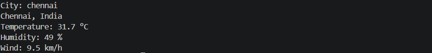

# Weather CLI

A command-line program that tells you the current weather for any city in the world. Type a city name and it shows the temperature, humidity and wind, using the free Open-Meteo API (no API key needed).



## How it works

1. You type a city name.
2. Open-Meteo's Geocoding API turns it into latitude and longitude.
3. Open-Meteo's Forecast API returns the current temperature, humidity and wind.
4. An unknown city gets "Sorry, I couldn't find that city." No internet gets "No internet connection. Check your Wi-Fi and try again."

## Run it

On Windows, in PowerShell or cmd:
```
git clone https://github.com/bhargavsaideekonda/weather-cli.git
cd weather-cli
python -m venv .venv
.\.venv\Scripts\python.exe -m pip install -r requirements.txt
.\.venv\Scripts\python.exe weather.py
```

## What I learned

1. How to use `requests` to call a web API, sending the parameters with `params={...}`.
2. How to get information from outside URLs: `r.json()` turns the reply into Python data.
3. How to show the information clearly for the user, each value with its unit.
4. How to handle errors: `find_city()` raises `ValueError` for an unknown city, and the program catches it, plus `ConnectionError` and `Timeout` when there's no internet.

I built this with step-by-step help from Claude, an AI tutor. I typed and ran every line myself.

## Credits

Weather and location data from [Open-Meteo](https://open-meteo.com).