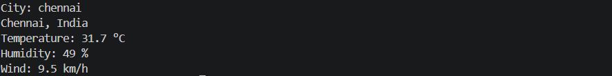

# Weather CLI

A command-line program that can tell the current weather report.

## How it works

1. You type a city name.
2. Open-Meteo's Geocoding API turns it into latitude and longitude.
3. Open-Meteo's Forecast API returns the current temperature, humidity and wind.
4. An unknown city gets "Sorry, I couldn't find that city.". No internet gets "No internet connection. Check your Wi-Fi and try again.".


## Run it

On Windows, run these in cmd:
```
git clone https://github.com/bhargavsaideekonda/weather-cli.git
cd weather-cli
python -m venv .venv
.\.venv\Scripts\python.exe -m pip install -r requirements.txt
.\.venv\Scripts\python.exe weather.py
```

## Example
the output will be like
City: chennai
Chennai, India
Temperature: 29.1 °C
Humidity: 77 %
Wind: 10.9 km/h

## What I learned

1. i learn how to use requests.
2. i learn how to get information from the outside urls.
3. i learn how to represent the information for the user.

## Credits

Weather and location data from [Open-Meteo](https://open-meteo.com).